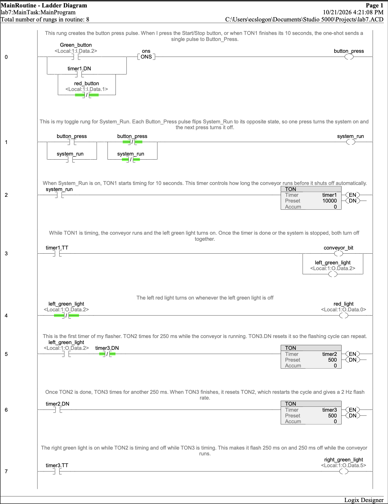
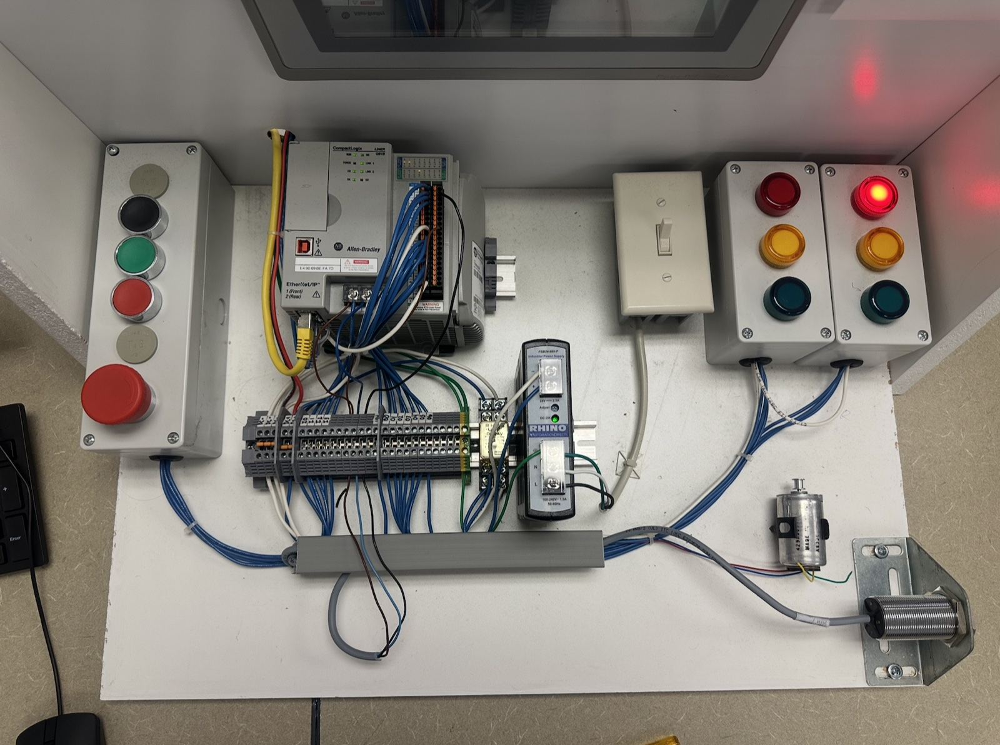

# CompactLogix Conveyor Start/Stop with Auto Shutoff

## Overview
A conveyor control program for an Allen-Bradley CompactLogix PLC, written in Studio 5000 and tested on a physical lab station. One push button starts and stops the conveyor, a TON timer shuts the system off on its own after 10 seconds, and pilot lights show the conveyor state. The left green light is on while the conveyor runs, the right green light flashes 500 ms on and 500 ms off, and the left red light is on while the conveyor is stopped.

The program combines two earlier building blocks: a one-shot (ONS) toggle that lets one button act as both Start and Stop, and TON timers. Feeding the 10-second timer's done bit back into the one-shot lets the timer "press the button" itself and turn the system off.

I/O mapping:
- Green push button (Start/Stop): `Local:1:I.Data.2`
- Red push button (Stop): `Local:1:I.Data.1`
- Left green light: `Local:1:O.Data.2`
- Left red light: `Local:1:O.Data.0`
- Right green light: `Local:1:O.Data.5`

Internal tags:
- `button_press`: single-scan pulse from the button, or from the timer
- `ons`: ONS storage bit
- `system_run`: start/stop toggle state
- `conveyor_bit`: conveyor running
- `timer1`: TON, 10 s automatic shutoff (preset 10000 ms)
- `timer2`: TON, first half of the flasher (preset 500 ms)
- `timer3`: TON, second half of the flasher (preset 500 ms)

### Logic as built
- **Rung 0:** An ONS pulses `button_press` once when the Start/Stop button is pressed or when `timer1.DN` comes on, so the timer can shut the system off automatically. The Stop button is on a parallel branch with the timer.
- **Rung 1:** Toggles `system_run` on each `button_press` pulse (XOR seal-in), so one press starts the system and the next press stops it.
- **Rung 2:** Runs `timer1` (10 s) while `system_run` is on.
- **Rung 3:** Drives `conveyor_bit` and the left green light from `timer1.TT`, so both turn off together when the timer finishes or the system stops.
- **Rung 4:** Turns on the left red light through an XIO of the left green light, so red means the conveyor is stopped.
- **Rung 5:** Runs `timer2` (500 ms) while the conveyor runs. `timer3.DN` resets it.
- **Rung 6:** Runs `timer3` (500 ms) after `timer2` finishes. When `timer3` finishes, it resets `timer2` and the cycle repeats.
- **Rung 7:** Drives the right green light from `timer3.TT`, so it flashes 500 ms on and 500 ms off while the conveyor runs.

### Debugging
The left red light first worked backwards: it came on while the system was running. Driving it from an XIO contact of the left green light fixed it, so it is now on whenever the conveyor is off.

### Testing
The program downloaded with no errors. Tested on hardware:
- Start turns on the conveyor and the left green light.
- After 10 seconds, the system shuts off automatically and the red light comes on.
- Stop during a run turns everything off.
- The right green light flashes at a steady 500 ms on / 500 ms off while the conveyor runs.

## Tech / Tools
Studio 5000, CompactLogix, RSLinx, ladder logic, ONS one-shot, TON timers, two-timer flasher

## Screenshots

*Eight-rung ladder logic program in Studio 5000*

*Physical lab station: CompactLogix PLC, push buttons, and pilot lights during testing (red light on with the conveyor stopped)*

## Status
Complete
