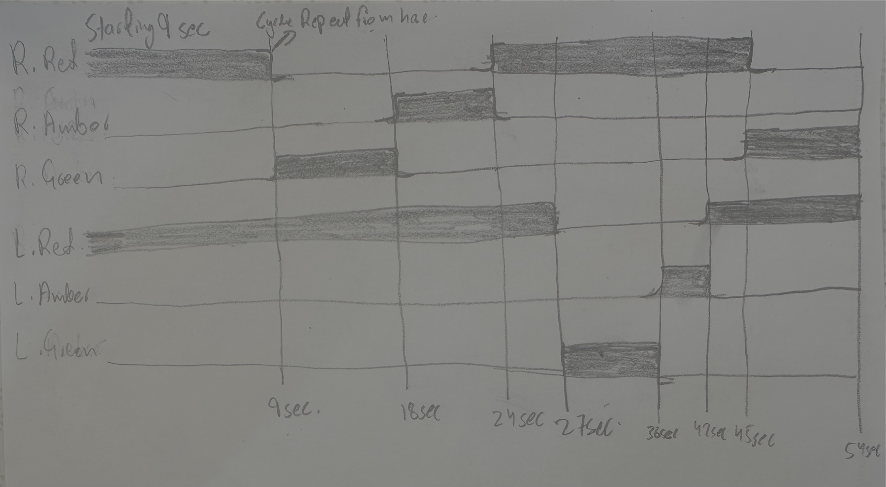
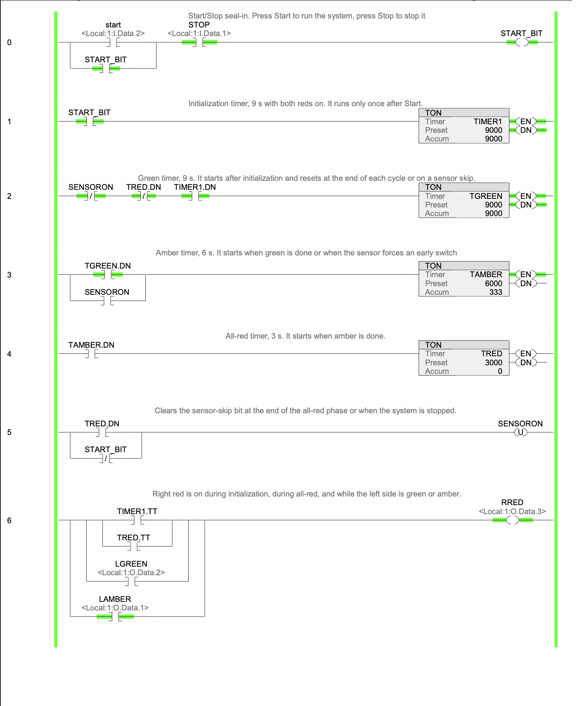
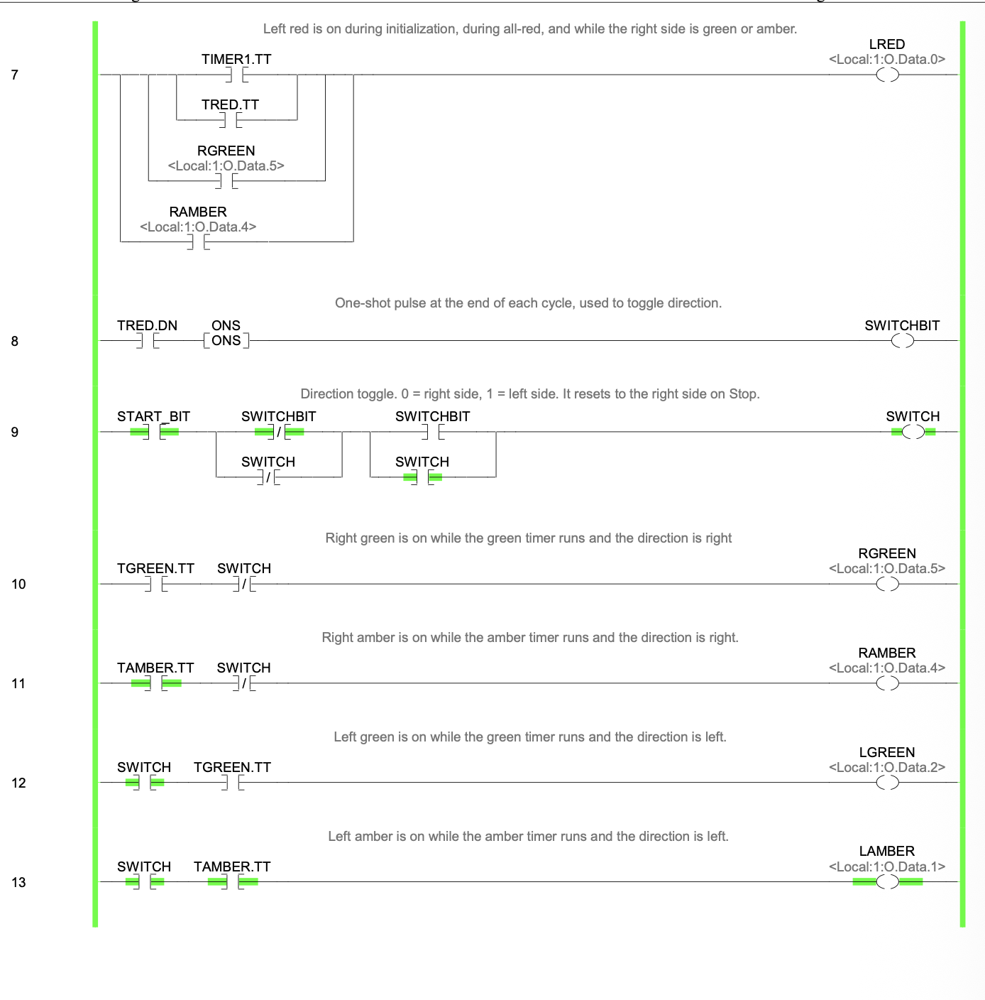
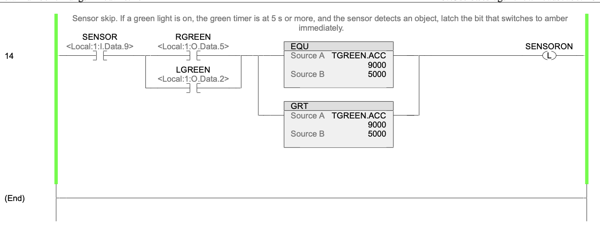
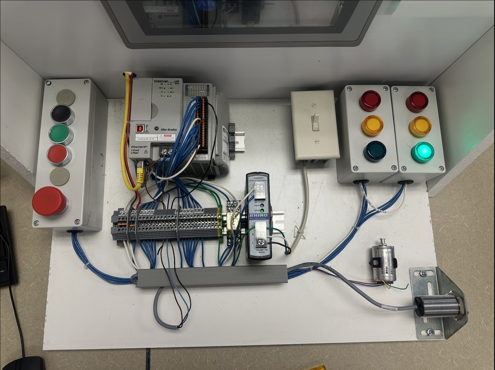

# CompactLogix Traffic Light Controller

## Overview
A two-direction traffic light controller for an intersection, built on an Allen-Bradley CompactLogix PLC in Studio 5000 and tested on a physical lab station. A Start/Stop push button runs and stops the system. On start, both directions show red for 9 seconds. The lights then run a continuous Green → Amber → Red sequence that alternates between the two directions. A proximity sensor watches traffic flow: if a green light has been on for 5 seconds or more and the sensor detects an object, the system switches to amber early.

The sequence is built from four chained TON timers. Each phase's DN bit starts the next phase, and each phase's TT bit keeps its light on while the timer runs. A one-shot and an XOR toggle flip the active direction once per cycle, and compare instructions let the sensor cut the green phase short.

### Timing
| Phase | Duration | Lights |
|-------|----------|--------|
| Initialization (once after Start) | 9 s | Both reds |
| Green | 9 s | Active side green, other side red |
| Amber | 6 s | Active side amber, other side red |
| All-red | 3 s | Both reds, then the direction switches |

I/O mapping:
- Start push button: `Local:1:I.Data.2`
- Stop push button: `Local:1:I.Data.1`
- Proximity sensor: `Local:1:I.Data.9`
- Left red / amber / green: `Local:1:O.Data.0` / `.1` / `.2`
- Right red / amber / green: `Local:1:O.Data.3` / `.4` / `.5`

Internal tags:
- `START_BIT`: start/stop run state
- `SWITCH`: direction (0 = right side, 1 = left side)
- `SWITCHBIT`: one-shot pulse at the end of each cycle
- `SENSORON`: latched sensor-skip bit
- `TIMER1`: TON, 9 s initialization
- `TGREEN`: TON, 9 s green phase
- `TAMBER`: TON, 6 s amber phase
- `TRED`: TON, 3 s all-red phase

### Logic as built
- **Rung 0:** Start/Stop seal-in for `START_BIT`.
- **Rung 1:** `TIMER1` (9 s) runs once after Start with both reds on.
- **Rung 2:** `TGREEN` (9 s) starts after initialization and resets at the end of each cycle (`TRED.DN`) or on a sensor skip (`SENSORON`).
- **Rung 3:** `TAMBER` (6 s) starts when green is done or when `SENSORON` forces an early switch.
- **Rung 4:** `TRED` (3 s) starts when amber is done.
- **Rung 5:** Unlatches `SENSORON` at the end of the all-red phase or when the system stops.
- **Rungs 6–7:** Each red light is on during initialization, during all-red, and while the opposite side is green or amber.
- **Rung 8:** An ONS on `TRED.DN` pulses `SWITCHBIT` once at the end of each cycle.
- **Rung 9:** An XOR toggle flips `SWITCH` on each pulse and resets it to the right side on Stop.
- **Rungs 10–13:** The green and amber lights are driven by `TGREEN.TT` and `TAMBER.TT`, gated by `SWITCH` for right or left.
- **Rung 14:** If a green light is on, `TGREEN.ACC` is at least 5000 ms (EQU/GRT pair), and the sensor detects an object, `SENSORON` latches to switch to amber immediately.

### Debugging
1. **The sensor did not actually end the green phase.** The amber light came on, but the green timer kept running and the amber timer never started, so the lights flickered. Fixed by making the sensor bit a latch (`SENSORON`) that resets the green timer and starts the amber timer.
2. **The direction sometimes switched twice, so the same side ran twice in a row.** This came from latching and unlatching the direction on different timer bits. Fixed by using a one-shot on the all-red done bit that feeds a single XOR rung, so the direction flips exactly once per cycle.

### Testing
The program downloaded with no errors. Tested on hardware:
- Start gives 9 seconds of both reds, then the right side runs green (9 s), amber (6 s), and all-red (3 s), and the left side follows with the same sequence. The cycle keeps alternating.
- Stop halts the system and resets the direction to the right side.
- Triggering the sensor after a green light has been on for 5 seconds or more switches to amber immediately.

## Tech / Tools
Studio 5000, CompactLogix, RSLinx, ladder logic, TON timers, ONS one-shot, XOR toggle, EQU/GRT compare instructions, proximity sensor

## Screenshots

*Hand-drawn timing diagram: 9 s initialization, then alternating green, amber, and all-red phases for the right and left sides*

*Rungs 0–6: Start/Stop seal-in, the four phase timers, sensor-bit reset, and right red light*

*Rungs 7–13: left red light, one-shot and XOR direction toggle, and green/amber outputs*

*Rung 14: sensor skip using EQU/GRT compares on the green timer*

*Physical lab station during testing: CompactLogix PLC, push buttons, proximity sensor, and the two traffic light stacks*

## Status
Complete
